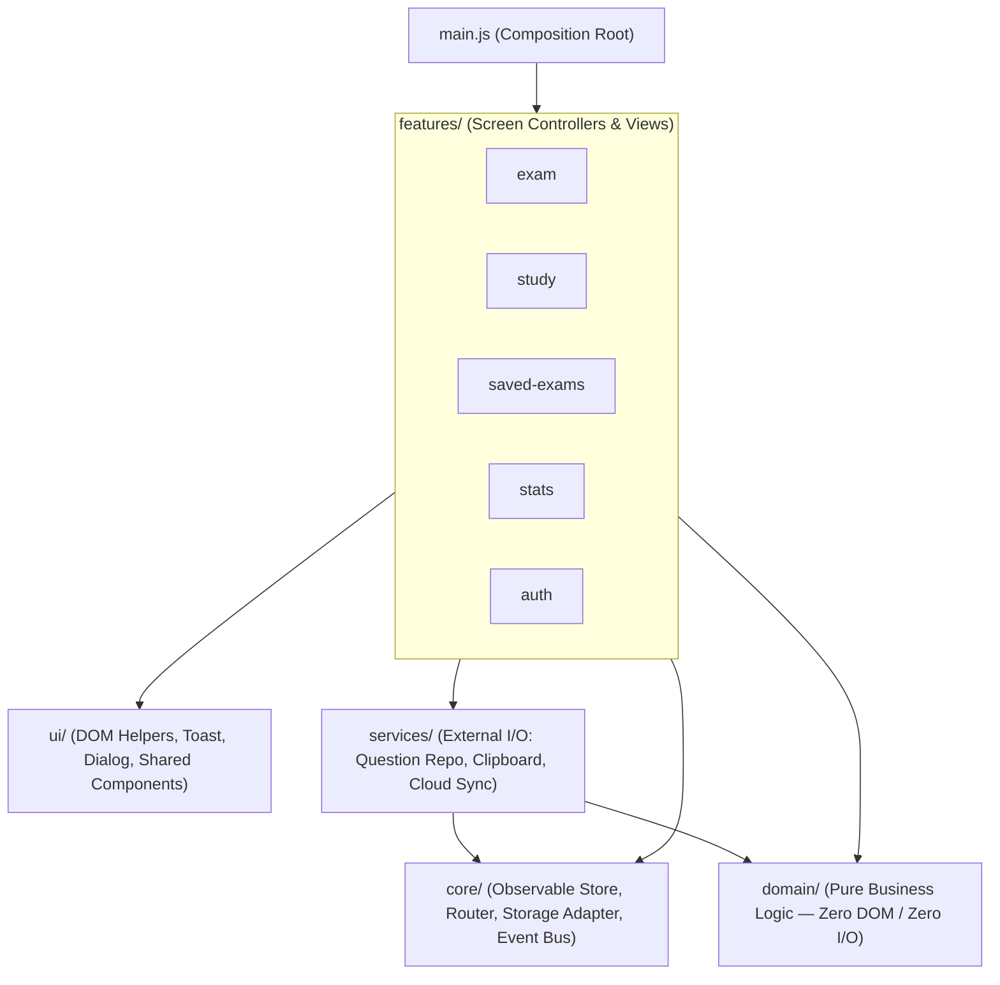

# 01 — Architecture Standard

## 1. Architectural Vision

The application is a client-side Single-Page Application (SPA) built with **native Vanilla JavaScript (ES2022+ Modules)**, semantic HTML5, and modern CSS (`@layer` + custom properties), backed by static JSON data and optional Firebase Cloud Sync (Auth + Firestore).

The architecture enforces strict **Separation of Concerns (SoC)** and **Unidirectional Data Flow** so that business rules can be tested in Node.js in milliseconds without a browser, and UI views can be swapped or restyled without touching domain logic.

---

## 2. Layered Architecture & Dependency Rule

### The Strict Dependency Rule

| Layer | Allowed to Import From | Forbidden to Import From | Environment |
|---|---|---|---|
| `config.js` | *(none)* | All layers | Universal (Node + Browser) |
| `domain/*` | `config.js`, other `domain/*` | `core/*`, `services/*`, `ui/*`, `features/*`, `window`, `document`, `localStorage` | Universal (100% pure JS) |
| `core/*` | `config.js`, `domain/*` | `services/*`, `ui/*`, `features/*` | Universal / Browser |
| `ui/*` | `config.js`, `core/*` | `domain/*`, `services/*`, `features/*` | Browser / `happy-dom` |
| `services/*` | `config.js`, `core/*`, `domain/*` | `ui/*`, `features/*` | Browser (with injectable adapters) |
| `features/*` | `config.js`, `core/*`, `domain/*`, `services/*`, `ui/*` | Other `features/*` (communicate via `store` or `router`) | Browser / `happy-dom` |
| `main.js` | All layers | *(nothing imports `main.js`)* | Browser entry point |

---

## 3. Unidirectional Data Flow

All user interactions and state transitions follow a single predictable loop:

1. **User Event**: User clicks/changes an element with `data-action="..."`.
2. **Delegated Dispatch (`core/events.js`)**: Event listener routes the action to the active feature controller.
3. **Domain Computation (`domain/*`)**: Controller calls pure domain functions with current state and action payload to compute the next state.
4. **State Transition (`core/store.js`)**: Controller commits the new state via `store.setState(...)`.
5. **Side-Effects & Persistence**: Store subscribers persist relevant slices to `localStorage`/`sessionStorage` (`core/storage.js`) and schedule cloud sync (`services/cloud-sync.js`).
6. **View Re-render (`features/*.view.js`)**: Subscribed view functions render the updated state into the DOM using auto-escaped HTML templates (`ui/dom.js`).

---

## 4. Module Responsibilities

### `domain/` (Pure Business Rules)
- **`shuffle.js`**: Fisher-Yates array shuffle and option-shuffling with preserved `correctIndex`. Accepts an optional `rng` function (`() => number`) for deterministic unit tests.
- **`question-pool.js`**: Quarantined ID calculation, active pool filtering (by source, category, mistakes-only), and full-exam eligibility detection.
- **`exam-session.js`**: Creating an exam session, selecting an option, toggling distractor elimination (and clearing conflicting selection), flagging questions, navigating, and computing final score/breakdown.
- **`study-session.js`**: Filtering study questions, recording immediate answers, updating mistakes/stats deltas, navigating next/prev with wrap-around reshuffle.
- **`saved-exams.js`**: Reserving up to 3 full exams, preventing duplicates/overflow, starting a saved exam, marking completion scores, and releasing exams back to the active pool.
- **`stats.js`**: Computing overall accuracy, per-category accuracy, and identifying the weakest category for targeted practice.
- **`explanation-parser.js`**: Parsing raw explanation text into structured rationale and per-distractor breakdown while stripping internal literature source lines (`• מקור בספרות`).
- **`ai-prompt.js`**: Formatting a question and its current shuffled options into the structured Hebrew LLM prompt.
- **`sync-merge.js`**: Deterministic merging of local and remote cloud state (including timestamps/tombstones so deletions and resets propagate cleanly).

### `core/` (Application Plumbing)
- **`store.js`**: Lightweight observable state container (`getState`, `setState`, `subscribe`).
- **`storage.js`**: Versioned (`v2`) wrapper around `localStorage` and `sessionStorage` with safe JSON serialization (`Set` ↔ `Array`) and quota/privacy error handling.
- **`router.js`**: Manages active tab (`exam`, `study`, `saved-exams`, `stats`), sub-screens (`SETUP`, `ACTIVE`, `RESULTS`), session persistence of active tab, and synchronizes desktop tabs with mobile bottom navigation.
- **`events.js`**: Declarative event delegation (`click`, `change`) via `data-action` attributes. Eliminates all inline `onclick` and `window.*` globals.

### `services/` (Boundary I/O)
- **`question-repository.js`**: Fetches and caches `data/questions.json`, validates basic structure, and exposes query helpers.
- **`clipboard.js`**: Async clipboard write with mobile-safe `execCommand('copy')` fallback; returns `{ ok: boolean }` and never triggers native `alert()`.
- **`cloud-sync.js`**: Encapsulates Firebase Auth and Firestore synchronization, listening to store changes and remote snapshots without polluting `window`.

### `ui/` (Reusable Presentation Primitives)
- **`dom.js`**: Tagged template literal `html` that **automatically HTML-escapes** all interpolated values unless explicitly wrapped in `raw()`, preventing XSS by default.
- **`toast.js`**: Non-blocking toast notification manager (`#appGlobalToast`).
- **`dialog.js`**: Accessible modal confirmation/alert `<dialog>` replacing blocking browser `alert()` and `confirm()`.
- **`components/explanation-card.js`**: Shared renderer for the pedagogical explanation and distractor cards used in both Study Mode and Exam Review.
