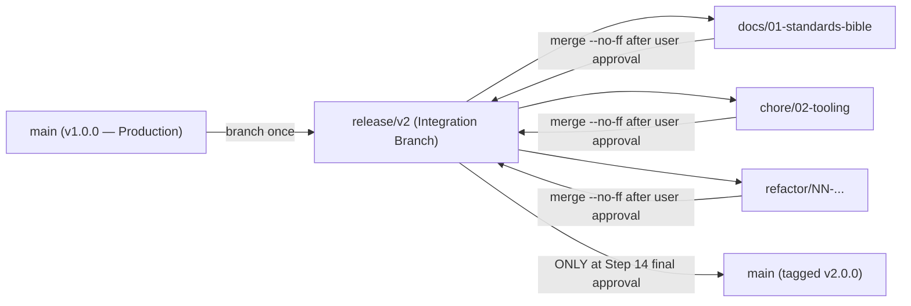

# 09 — Git Workflow & Release Standard

## 1. Branching Topology



### Rules of Engagement
1. **`main` Is Sacred**: Zero commits or merges are made to `main` during the entire v2 development cycle. `main` stays untouched at `v1.0.0` until Step 14 is explicitly approved by the user.
2. **Integration Branch (`release/v2`)**: Holds all completed, verified steps for v2.
3. **Step Branches**: Every step in the implementation plan is developed on its own dedicated branch cut from `release/v2`:
   - `docs/01-standards-bible`
   - `chore/02-tooling`
   - `test/03-safety-net`
   - `refactor/04-repo-structure`
   - `refactor/05-data-layer`
   - `refactor/06-css`
   - `refactor/07-js-core`
   - `refactor/08-domain`
   - `refactor/09a-feature-exam`, `09b-feature-study`, `09c-feature-saved-exams`, `09d-feature-stats`
   - `refactor/10-cloud-sync`
   - `fix/11-behavior-fixes`
   - `chore/12-quality-gates`
   - `docs/13-docs`
4. **Checkpoint Gate**: At the end of each step branch:
   - Run full verification suite (`npm run verify`).
   - Push the step branch to `origin`.
   - Present a **Checkpoint Report** (what changed, test counts, any deviations/surprises, next step recommendation) and wait for user approval before merging `--no-ff` into `release/v2`.

---

## 2. Commit Message Standard (Conventional Commits)

All commits must follow the [Conventional Commits](https://www.conventionalcommits.org/) specification:

```text
<type>(<scope>): <concise imperative summary>

[optional body explaining why, not just what]
```

- **Allowed `<type>` values**:
  - `feat`: New user-facing or developer feature
  - `fix`: Bug fix
  - `refactor`: Code restructuring with zero behavior change
  - `test`: Adding or updating automated tests
  - `docs`: Documentation or standards updates
  - `chore`: Build scripts, tooling, CI, or dependency updates
  - `style`: Formatting/CSS changes with no logic change
- **Examples**:
  - `docs(standards): author v2 engineering bible, ADRs, and initial STPR`
  - `refactor(domain): extract pure shuffle and question-pool modules`
  - `fix(sync): propagate stats reset and mistake removals via timestamps`

---

## 3. Tagging & Rollback Protocol

- **`v1.0.0`**: Points to the clean single-file release prior to v2 refactoring (`8ea2295`).
- **`v1.0.0-all-in-one`**: Points to the last commit containing `simulator_all_in_one.html` (`3317f4a`).
- **`v2.0.0`**: Annotated tag created on `main` upon completing Step 14.

### Emergency Rollback from v2 to v1
If an issue is discovered after v2 cutover:
1. In GitHub Settings → Pages, switch source back to `Deploy from a branch (main / root)` or revert the release merge commit on `main`:
   ```bash
   git checkout main
   git revert -m 1 <v2-merge-commit-sha>
   git push origin main
   ```
2. Or checkout `v1.0.0` directly.
